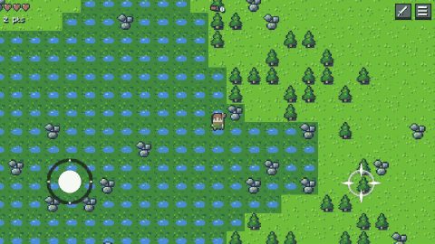

# flagoria
Flagoria - A Captivating Island Adventure!


Features:
- procedurally generated island world with biomes (oceanic, temperate, continental, dense archipelago), beaches, swamps, trees, bushes, flowers and stones; seeds and generation settings in **Map Settings**
- multiplayer over ENet (UDP `9786`) with UPnP port mapping; Host/Join from the main menu, or a headless dedicated server (`-- --server`, see [docs/dedicated-server.md](docs/dedicated-server.md))
- PVP with hearts: 3 hearts in half-heart steps, a short blink of invulnerability after each hit, respawn on death (half a heart back every 5 s)
- mobs (slimes, crabs, piglets) that wander, chase, hurt on contact and can be fought with the sword
- music, combat sound effects and footsteps, with Music and Sound effects volume in the main menu ([docs/audio.md](docs/audio.md))
- pinch-to-zoom (and mouse wheel or Ctrl +/-) for the local camera
- generated hero sprites ([docs/hero-sprites.md](docs/hero-sprites.md)) and app icon ([art/icon/README.md](art/icon/README.md))
- Android debug builds (below)


## Gameplay



Recorded from [v1.4.0-test.9](https://github.com/peterdays/flagoria/releases/tag/v1.4.0-test.9) on desktop: walking the island, cutting trees in interact mode (the wood counter goes from 0 to 12), and a slime fight that adds kill points to the points counter.


## How to check a change

```bash
./tools/verify.sh
```

This imports the project, opens it again in the headless editor to check that it loads without errors, parses every script, runs the headless tests in `tests/run_tests.gd` (several of them instantiate the main scene), runs the biome-coverage, audio and generator smoke checks, and compares a seed-42 map render with `tests/golden/map_render_seed42.txt`. It ends with `Verification passed.` and exits `0`. CI runs the same script on every pull request. `GODOT` selects the Godot binary (default `godot`).

- Per-feature recipes, including manual checks for things the headless run cannot see, are in [.cursor/skills/verify-flagoria/features/](.cursor/skills/verify-flagoria/features/README.md).
- Multiplayer changes also need the two-player checklist below.
- Contributor and agent rules, including the pull request size cap, are in [AGENTS.md](AGENTS.md).
- Where each script lives and where new code goes: [docs/architecture.md](docs/architecture.md).

## Map command line

Render or measure a generated map without opening the game:

```bash
godot --headless --path . --script res://tools/cli.gd -- map render --seed 42
godot --headless --path . --script res://tools/cli.gd -- map stats --seed 42 --out stats.json
```

- `map render` prints the origin chunk as ASCII, one character per tile type: `~` water, `.` sand, `%` swamp, `&` special swamp, `,` grass, `T` tree, `b` bush, `*` flower, `o` stones. A plant or stones replaces the ground under it.
- `map stats` prints JSON: tile counts, water/land ratio, island count, and tree and bush density per land cell.
- `--params <file>` reads a map save (`MapSave`); the default is `default`, the default map settings. `--seed n` sets the altitude, moisture, temperature, items and biome seeds to n to n+4. Without `--seed`, every seed must come from the map save, so output never depends on a random seed.
- `--out <path>` writes a file instead of stdout. The same inputs give byte-identical output.
- Exit codes: `0` ok, `1` error (for example, a missing map save), `2` bad usage.

## Android test builds

Debug APKs are published as pre-releases on the Releases page. See [docs/android-apk.md](docs/android-apk.md) for download and install steps.

## Two-player play-test checklist

Use two instances on one machine. Empty join address means localhost.

1. **Host** — Instance A: Main Menu → Host. Confirm the world loads and a local player spawns.
2. **Join** — Instance B: Main Menu → Join (leave address empty for localhost, or enter the host address). Confirm the second player appears for both.
3. **Move** — Move both players with keyboard or on-screen joystick; each should see the other move.
4. **Attack** — Attack (space / attack button) near the other player; confirm the hit player loses half a heart in the top-left hearts on their own screen and blinks on both screens.
5. **Regen** — After taking damage, wait for the regen timer; confirm half a heart comes back (unless dead).
6. **Death** — Hit a player down to zero hearts; confirm they disappear, then respawn at the spawn point with full hearts on both screens.

